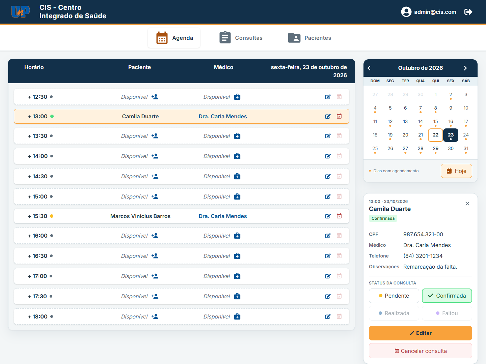
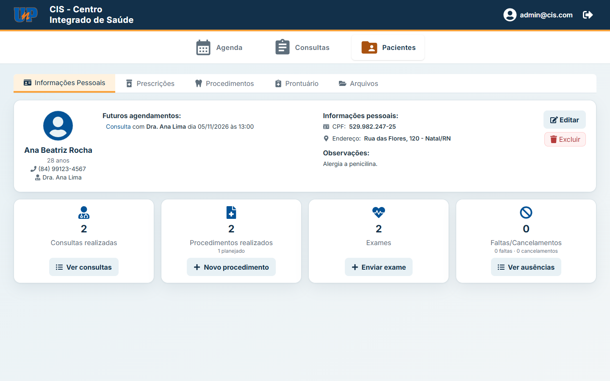
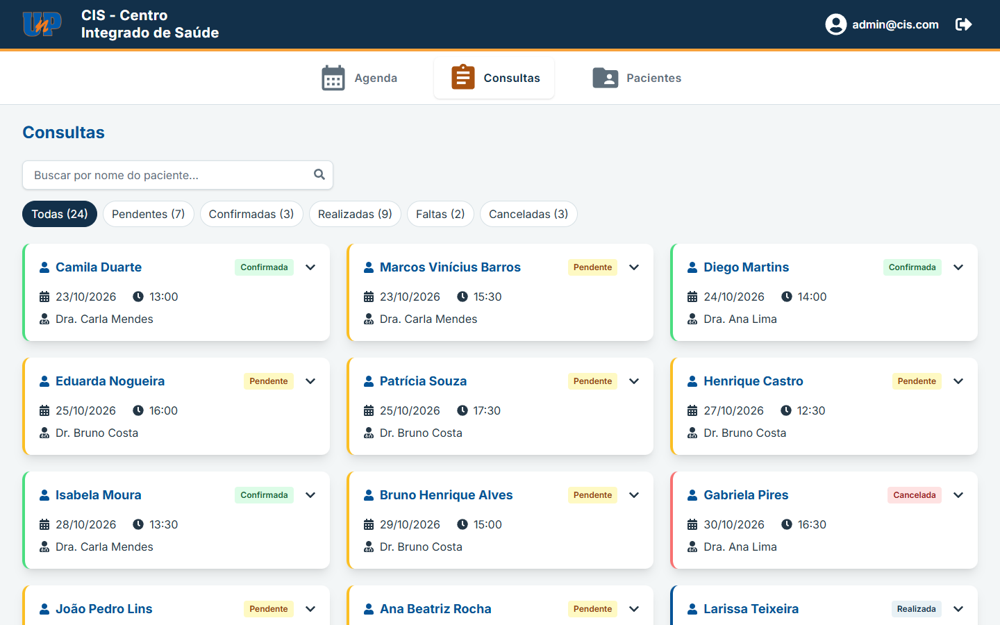
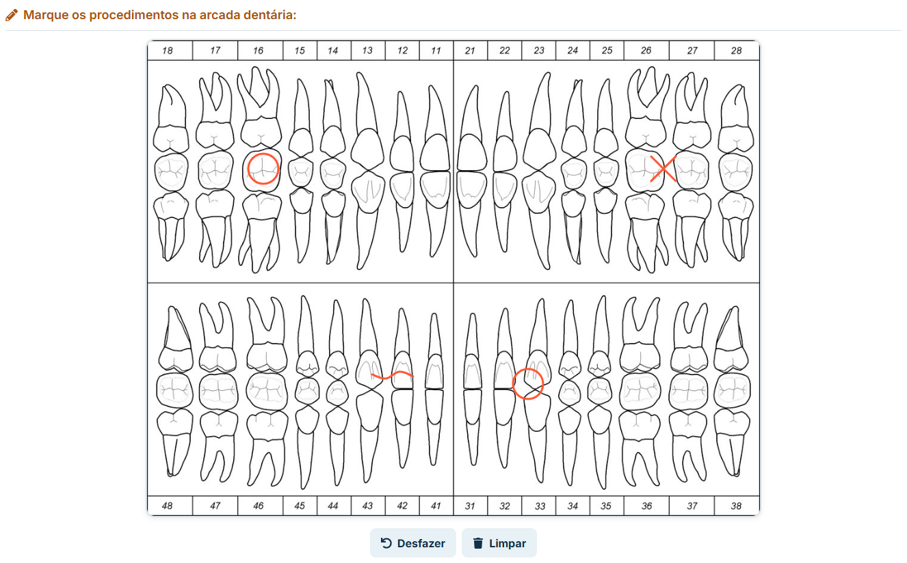
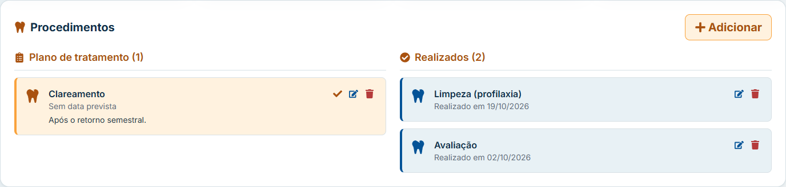
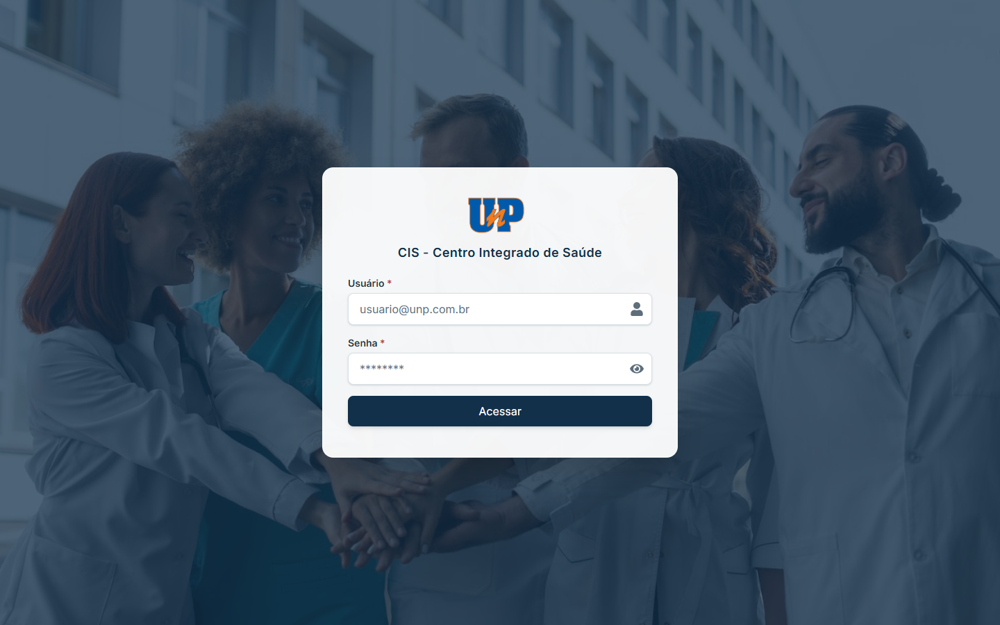
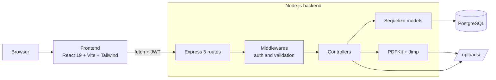
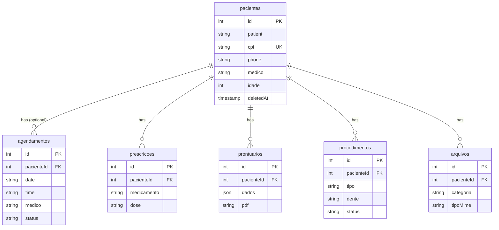

# CIS UNP — Integrated Health Center

[Português](README.md) · **English**

Full stack web application for the dental clinic of UNP's Integrated Health Center (Centro Integrado de Saúde): patients, scheduling, appointments, procedures, prescriptions, file storage and a dental record with PDF generation.




> The interface is in Brazilian Portuguese, since the system was built for a clinic in Brazil.

## Contents

- [About](#about)
- [Features](#features)
- [Screenshots](#screenshots)
- [Technical highlights](#technical-highlights)
- [Challenges](#challenges)
- [Architecture](#architecture)
- [Tech stack](#tech-stack)
- [Getting started](#getting-started)
- [Tests](#tests)
- [API](#api)
- [Roadmap](#roadmap)
- [Author](#author)
- [License](#license)

## About

CIS UNP started as a **scientific project at Universidade Potiguar (UNP)**, in Brazil. At the university's dental teaching clinic, students recorded appointments, clinical forms and prescriptions **on paper or in Excel spreadsheets**. This led to rework, double-booked time slots, scattered information and the usual errors of manual transcription.

The goal of the system is to **replace that manual work**: bring patient records, scheduling, clinical history and dental records together in one place, so students and staff spend less time on paperwork and more time with patients.

I built the project **on my own, end to end, since May 2025**: requirements, database modeling, API, user interface, tests and documentation. It is an **educational project** and **still under development**, but its core features are already **ready to use**.

## Features

### Scheduling and appointments

- Daily schedule with a calendar, markers for days with appointments, and past time slots shown as closed.
- Patient lookup by name or CPF (Brazilian taxpayer ID) while typing.
- Appointment status: **pending, confirmed, completed, no-show and cancelled**, each with its own color.
- Double booking prevented at the database level. Cancelling frees the slot; a no-show keeps the record.
- Appointments cannot be booked in the past.
- Walk-in appointments (no CPF) or linked to a patient record: booking with a CPF creates the patient or updates their name and phone.
- Appointments page with status filters, counters and patient search.

### Patients

- Create, search, edit and delete patients (deleting keeps the whole clinical history).
- Patient overview with counts computed in the database: completed appointments, procedures, exams, no-shows and cancellations.
- Phone input mask, stored as digits only and displayed as `(84) 99999-0000`.

### Clinical area

- **Dental record**: health questionnaire, clinical examination and **freehand drawing over a dental chart**, exported to PDF.
- **Procedures**: treatment plan and completed procedures, with the tooth in FDI notation.
- **Prescriptions** per patient.
- **Files**: upload, download and deletion of exams and documents (PDF or image, up to 10 MB).

### Security and validation

- JWT authentication with a mandatory password change on first login.
- An expired session opens a login modal without leaving the page, and the interrupted request is retried afterwards.
- Validation of CPF (including check digits), e-mail, password, phone, dates, times and required fields, with readable messages on screen.

## Screenshots

| Patient overview                                                                                         | Appointments                                                        |
| -------------------------------------------------------------------------------------------------------- | ------------------------------------------------------------------- |
|  |  |

| Dental record: dental chart markings                               | Treatment plan                                                     |
| ------------------------------------------------------------------ | ------------------------------------------------------------------ |
|  |  |

<details>
<summary>Login page</summary>



</details>

> Screenshots use fictitious data generated by the demo seeder.

## Technical highlights

- **Versioned database migrations** (`sequelize-cli`): every schema change is a new migration, including _data_ migrations (phone normalization, replacing CPF with a foreign key), covered by tests that run against data in the old format.
- **Normalized schema**: prescriptions, dental records, procedures, files and appointments reference the patient through `pacienteId` (foreign key with `ON DELETE RESTRICT`). CPF, name and phone live only in the patient record.
- **Rules enforced by PostgreSQL itself**: a **partial** unique index (`WHERE status <> 'cancelada'`) prevents two appointments in the same slot while letting a cancelled appointment free it; a `CHECK` constraint requires either a registered patient or a walk-in name.
- **Soft delete** for patients, with automatic reactivation when the same CPF is registered again. Operations that touch several tables run inside **transactions**.
- **98 automated tests** using Node's built-in runner (`node:test`), with no extra libraries: middlewares, HTTP routes and a real database. Tests use a separate database (`cis_test`), rebuilt from the migrations on every run and guarded against pointing at the wrong database.
- **Layered API**: `routes → validation middleware → controllers → models`. Every write route validates the request body before reaching the controller; responses follow a consistent pattern (`400` with `{ error, details }`, `404`, `201` on create).
- **Safe file uploads**: the request body is the raw file (`express.raw`), the file name on disk is generated by the server (UUID), the internal path never appears in responses, and downloads require authentication.
- **Organized frontend**: a custom `useBuscarDados` hook for all data fetching (loading, error, reload), an `apiFetch` wrapper that handles `401` with a new login and request retry, and reusable components (masked phone input, debounced patient search, status selector).
- **Demo data**: an idempotent seeder (safe to run repeatedly) with valid CPFs and dates relative to the day it runs.

## Challenges

**Scheduling and local time.** Appointment dates and times must be compared in the clinic's time zone, not UTC, to decide what "today" is, what is already past and what can still be booked. I centralized these rules in single backend functions reused by validation, the schedule and the patient overview. Slot occupancy rules came with it (cancelling frees the slot, a no-show does not), and they ended up enforced by the database through the partial unique index.

**Dental record with drawing and PDF.** The dental record combines a long form with a freehand drawing over the dental chart image. The drawing is exported from the browser as an image; on the server, Jimp overlays the strokes on the chart, both at the same size as the on-screen canvas (900×700), so each mark lands on the right tooth. PDFKit then builds the final document with the form answers and the marked chart.

**Evolving the database without losing data.** The project started with tables created by `sync()` and the CPF repeated across several tables. I moved to versioned migrations (registering the existing schema as the baseline) and then normalized the model, replacing the CPF with a foreign key in five tables. Existing data was preserved, and the migration has tests that run it against data in the old format.

## Architecture



<details>
<summary>Database schema</summary>



</details>

### Folder structure

```text
CISUNP/
├── backend/
│   ├── app.js            # builds the Express app (used by tests)
│   ├── index.js          # connects to the database and starts the server
│   ├── migrations/       # versioned database schema
│   ├── seeders/          # demo data
│   ├── src/
│   │   ├── routes/
│   │   ├── middleware/   # authentication and validation
│   │   ├── controllers/
│   │   ├── models/
│   │   └── utils/
│   └── tests/            # node:test
├── frontend/
│   └── src/
│       ├── components/
│       ├── hooks/
│       └── utils/
└── docs/prints/          # images used in this README
```

## Tech stack

| Layer    | Technologies                                                                                       |
| -------- | -------------------------------------------------------------------------------------------------- |
| Frontend | React 19, Vite 8, Tailwind CSS 4, React Router 7, react-calendar, react-sketch-canvas, React Icons |
| Backend  | Node.js 20.19+, Express 5, Sequelize 6, sequelize-cli, JWT, bcrypt, PDFKit, Jimp                   |
| Database | PostgreSQL                                                                                         |
| Quality  | `node:test`, ESLint 10 (with `react-hooks` 7), Prettier                                            |

## Getting started

### Prerequisites

- Node.js 20.19 or later.
- A running PostgreSQL server with a database for the project (e.g. `cisunp`).

### 1. Backend

Create `backend/.env`:

```env
DB_NAME=cisunp
DB_USER=postgres
DB_PASS=your-password
DB_HOST=localhost
DB_PORT=5432
JWT_SECRET=a-long-random-local-secret
ADMIN_PASSWORD=your-initial-password
PORT=3001
```

All variables are required. `ADMIN_PASSWORD` is the administrator's initial password, changed on first login.

```bash
cd backend
npm install
npm run db:migrate   # creates the tables
npm run db:seed      # optional: demo data
npm run dev
```

### 2. Frontend

Create `frontend/.env` with the backend URL:

```env
VITE_API_URL=http://localhost:3001
```

In another terminal:

```bash
cd frontend
npm install
npm run dev
```

Open `http://localhost:5173` and sign in with `admin@cis.com` and the password set in `ADMIN_PASSWORD`.

<details>
<summary>Other commands</summary>

| Command (in `backend/`)     | What it does                                         |
| --------------------------- | ---------------------------------------------------- |
| `npm start`                 | Starts the server without auto-restart               |
| `npm run db:migrate:status` | Lists applied migrations                             |
| `npm run db:migrate:undo`   | Reverts the last migration                           |
| `npm run db:seed:undo`      | Removes the demo data (login users are not affected) |

| Command (in `frontend/`) | What it does          |
| ------------------------ | --------------------- |
| `npm run lint`           | Runs ESLint           |
| `npm run build`          | Builds for production |

The seeder can run more than once: it replaces the previous demo data, and appointment dates are relative to the day it runs.

</details>

## Tests

Tests live in [`backend/tests`](backend/tests) and use a separate database, `cis_test`, so development data is never touched. Create it once, with the same credentials as `.env`:

```sql
CREATE DATABASE cis_test;
```

Then, in `backend/`:

```bash
npm test
```

On every run, the `cis_test` tables are dropped and rebuilt from the migrations. As a safeguard, the tests stop with an error if they point at any other database.

## API

Clinical routes require the `Authorization: Bearer <token>` header.

<details>
<summary>All routes</summary>

| Method                      | Route                          | Description                             |
| --------------------------- | ------------------------------ | --------------------------------------- |
| `POST`                      | `/api/login`                   | Login (returns the JWT)                 |
| `GET`                       | `/api/session`                 | Checks the current session              |
| `POST`                      | `/api/change-password`         | Password change (first login)           |
| `GET` `POST` `PUT` `DELETE` | `/api/pacientes`               | Patients                                |
| `GET`                       | `/api/pacientes/busca?q=`      | Search by name or CPF prefix            |
| `GET`                       | `/api/pacientes/:cpf/resumo`   | Patient overview counts                 |
| `GET` `POST` `PUT` `DELETE` | `/api/agendamentos`            | Schedule                                |
| `GET`                       | `/api/agendamentos/todos`      | All appointments (Appointments page)    |
| `PATCH`                     | `/api/agendamentos/:id/status` | Changes an appointment's status         |
| `GET` `POST` `PUT` `DELETE` | `/api/procedimentos`           | Treatment plan and completed procedures |
| `GET` `POST`                | `/api/prescricoes`             | Prescriptions                           |
| `GET` `POST`                | `/api/prontuarios`             | Dental records (generates the PDF)      |
| `GET` `POST` `DELETE`       | `/api/arquivos`                | Exams and documents                     |
| `GET`                       | `/api/arquivos/:id/download`   | Authenticated download                  |

File upload (`POST /api/arquivos?cpf=...&categoria=...&nome=...`) takes the raw file as the request body, with the file's `Content-Type` (`application/pdf`, `image/png`, `image/jpeg` or `image/webp`).

</details>

## Roadmap

- [ ] Multi-provider scheduling, configurable hours, blocked dates (holidays, weekends) and a weekly view.
- [ ] Date of birth instead of age.
- [ ] Editing prescriptions and linking procedures to appointments.
- [ ] Tests for the dental record PDF and continuous integration (GitHub Actions).
- [ ] Responsiveness and keyboard navigation improvements.

## Author

**Giovanni Felipe Oliveira da Silva** — full stack developer

[](https://www.linkedin.com/in/giovanni-felipe-dev)
[](https://giovanni-felipe-dev.vercel.app/)
[](https://github.com/unrealgio)
[](mailto:giovannifelipedev@gmail.com)

## License

All rights reserved. The code is published for viewing and evaluation only (portfolio); copying, modifying, distributing or using it in other projects is not permitted without the author's authorization. See [LICENSE](LICENSE).
