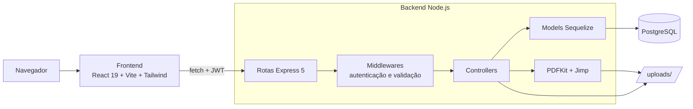
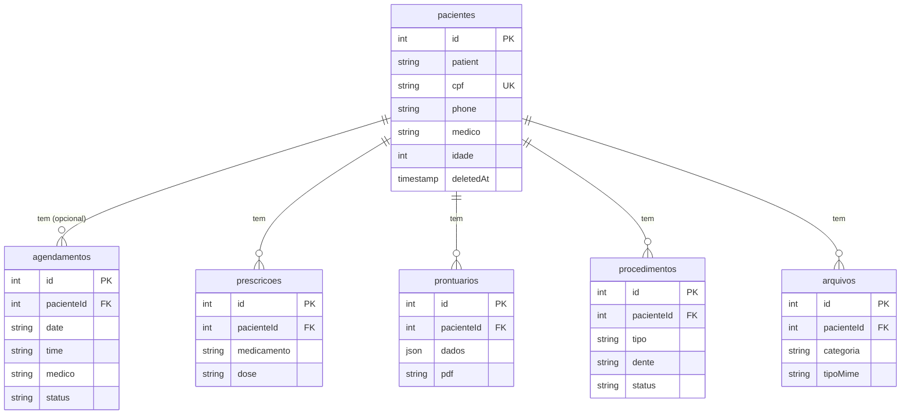

# CIS UNP — Centro Integrado de Saúde

**Português** · [English](README.en.md)

Sistema web full stack para a clínica odontológica do Centro Integrado de Saúde da UNP: pacientes, agenda, consultas, procedimentos, prescrições, arquivos e prontuário odontológico com geração de PDF.


## Sumário

- [Sobre o projeto](#sobre-o-projeto)
- [Funcionalidades](#funcionalidades)
- [Telas](#telas)
- [Destaques técnicos](#destaques-técnicos)
- [Desafios](#desafios)
- [Arquitetura](#arquitetura)
- [Tecnologias](#tecnologias)
- [Como executar](#como-executar)
- [Testes](#testes)
- [API](#api)
- [Próximos passos](#próximos-passos)
- [Autor](#autor)
- [Licença](#licença)

## Sobre o projeto

O CIS UNP nasceu de um **projeto científico da Universidade Potiguar (UNP)**. Na clínica-escola de odontologia, os estudantes registravam consultas, fichas clínicas e prescrições **em papel ou em planilhas do Excel**. Isso gerava retrabalho, horários marcados em duplicidade, informações espalhadas e erros típicos de digitação e transcrição manual.

O objetivo do sistema é **substituir esse trabalho manual**: reunir em um só lugar o cadastro do paciente, a agenda, o histórico clínico e o prontuário, para que os estudantes e profissionais gastem menos tempo com burocracia e mais tempo com o atendimento.

Desenvolvi o projeto **sozinho, do começo ao fim, desde maio de 2025**: levantamento das necessidades, modelagem do banco, API, interface, testes e documentação. É um projeto de caráter **didático** e **ainda em desenvolvimento**, mas as funcionalidades principais já estão **prontas para uso**.

## Funcionalidades

### Agenda e consultas

- Agenda diária com calendário, indicação dos dias com agendamento e horários passados marcados como encerrados.
- Busca do paciente cadastrado enquanto se digita o nome ou o CPF.
- Status de cada consulta: **pendente, confirmada, realizada, faltou e cancelada**, com cores próprias.
- Prevenção de horários duplicados no banco. Cancelar libera o horário; uma falta mantém o registro.
- Não é possível agendar em data ou horário que já passou.
- Consulta avulsa (sem CPF) ou vinculada ao cadastro: agendar com CPF cria o paciente ou atualiza nome e telefone.
- Página de consultas com filtros por status, contadores e busca por paciente.

### Pacientes

- Cadastro, busca, edição e exclusão (a exclusão preserva todo o histórico clínico).
- Ficha com resumo calculado no banco: consultas realizadas, procedimentos, exames, faltas e cancelamentos.
- Telefone com máscara durante a digitação, armazenado só com os dígitos e exibido como `(84) 99999-0000`.

### Área clínica

- **Prontuário odontológico**: anamnese, exame clínico e **desenho livre sobre a arcada dentária**, exportado em PDF.
- **Procedimentos**: plano de tratamento e histórico de realizados, com o dente na numeração FDI.
- **Prescrições** por paciente.
- **Arquivos**: envio, download e exclusão de exames e documentos (PDF ou imagem, até 10 MB).

### Segurança e validação

- Autenticação com JWT e troca de senha obrigatória no primeiro acesso.
- Sessão expirada abre um modal de login sem sair da tela, e a ação interrompida é refeita depois.
- Validação de CPF (com dígitos verificadores), e-mail, senha, telefone, datas, horários e campos obrigatórios, com mensagens legíveis na tela.

## Telas

| Ficha do paciente                                                                                            | Consultas                                                                |
| ------------------------------------------------------------------------------------------------------------ | ------------------------------------------------------------------------ |
|  |  |

| Prontuário: marcação na arcada dentária                                         | Plano de tratamento                                                     |
| ------------------------------------------------------------------------------- | ----------------------------------------------------------------------- |
|  |  |

<details>
<summary>Tela de login</summary>


</details>

> As telas usam dados fictícios gerados pelo seeder de demonstração.

## Destaques técnicos

- **Banco versionado por migrations** (`sequelize-cli`): toda mudança de estrutura é uma migration nova, inclusive migrations de _dados_ (normalização de telefones, troca do CPF por chave estrangeira), cobertas por testes que rodam sobre dados no formato antigo.
- **Modelo normalizado**: prescrições, prontuários, procedimentos, arquivos e agendamentos se ligam ao paciente por `pacienteId` (chave estrangeira com `ON DELETE RESTRICT`). CPF, nome e telefone ficam guardados só no cadastro do paciente.
- **Regras garantidas no próprio PostgreSQL**: índice único **parcial** (`WHERE status <> 'cancelada'`) impede dois agendamentos no mesmo horário, mas deixa uma consulta cancelada liberar a vaga; uma restrição `CHECK` exige paciente cadastrado ou nome avulso.
- **Exclusão suave** (_soft delete_) de pacientes com reativação automática ao recadastrar o mesmo CPF. Operações que alteram várias tabelas rodam em **transações**.
- **98 testes automatizados** com o executor nativo do Node (`node:test`), sem bibliotecas extras: middlewares, rotas HTTP e banco real. Os testes usam um banco separado (`cis_test`), recriado pelas migrations a cada execução e protegido contra apontar para o banco errado.
- **API em camadas**: `routes → middleware de validação → controllers → models`. Toda rota de escrita valida o corpo antes do controller; erros seguem um padrão (`400` com `{ error, details }`, `404`, `201` ao criar).
- **Upload seguro de arquivos**: o corpo da requisição são os bytes do arquivo (`express.raw`), o nome no disco é gerado pelo servidor (UUID), o caminho interno nunca sai nas respostas e o download é autenticado.
- **Frontend organizado**: hook próprio `useBuscarDados` para todas as buscas (carregando, erro, recarregar), `apiFetch` que trata `401` com novo login e reenvio da requisição, e componentes reutilizáveis (campo de telefone com máscara, busca de paciente com _debounce_, seletor de status).
- **Dados de demonstração**: seeder idempotente (pode rodar várias vezes) com CPFs válidos e datas calculadas a partir do dia da execução.

## Desafios

**Agenda e horário local.** Datas e horas da agenda precisam ser comparadas no fuso da clínica, e não em UTC, para decidir o que é "hoje", o que já passou e o que ainda pode ser agendado. Centralizei essas regras em funções únicas no backend e as reutilizei na validação, na agenda e nos resumos. Junto com isso vieram as regras de ocupação de horário: cancelar libera a vaga, faltar não. Elas acabaram resolvidas no próprio banco, com o índice único parcial.

**Prontuário com desenho e PDF.** O prontuário combina um formulário extenso com um desenho à mão livre sobre a imagem da arcada dentária. O desenho é exportado do navegador como imagem; no servidor, o Jimp sobrepõe o traço à imagem da arcada, as duas no mesmo tamanho do canvas da tela (900×700), para que cada marcação caia no dente certo. O PDFKit monta o documento final com as respostas da ficha e a arcada marcada.

**Evoluir o banco sem perder dados.** O projeto começou criando as tabelas com `sync()` e com o CPF repetido em várias tabelas. Migrei para migrations versionadas (registrando a estrutura existente como ponto de partida) e depois normalizei o modelo, trocando o CPF por uma chave estrangeira em cinco tabelas. Os dados existentes foram preservados, e a migração tem testes que a executam sobre dados no formato antigo.

## Arquitetura



<details>
<summary>Modelo do banco de dados</summary>



</details>

### Estrutura de pastas

```text
CISUNP/
├── backend/
│   ├── app.js            # monta o Express (usado pelos testes)
│   ├── index.js          # conecta ao banco e inicia o servidor
│   ├── migrations/       # estrutura do banco, versionada
│   ├── seeders/          # dados de demonstração
│   ├── src/
│   │   ├── routes/
│   │   ├── middleware/   # autenticação e validação
│   │   ├── controllers/
│   │   ├── models/
│   │   └── utils/
│   └── tests/            # node:test
├── frontend/
│   └── src/
│       ├── components/
│       ├── hooks/
│       └── utils/
└── docs/prints/          # imagens deste README
```

## Tecnologias

| Camada         | Tecnologias                                                                                        |
| -------------- | -------------------------------------------------------------------------------------------------- |
| Frontend       | React 19, Vite 8, Tailwind CSS 4, React Router 7, react-calendar, react-sketch-canvas, React Icons |
| Backend        | Node.js 20.19+, Express 5, Sequelize 6, sequelize-cli, JWT, bcrypt, PDFKit, Jimp                   |
| Banco de dados | PostgreSQL                                                                                         |
| Qualidade      | `node:test`, ESLint 10 (com `react-hooks` 7), Prettier                                             |

## Como executar

### Pré-requisitos

- Node.js 20.19 ou superior.
- PostgreSQL em execução, com um banco criado para o projeto (ex.: `cisunp`).

### 1. Backend

Crie `backend/.env`:

```env
DB_NAME=cisunp
DB_USER=postgres
DB_PASS=sua-senha
DB_HOST=localhost
DB_PORT=5432
JWT_SECRET=uma-chave-local-longa-e-aleatoria
ADMIN_PASSWORD=sua-senha-inicial
PORT=3001
```

Todas as variáveis são obrigatórias. `ADMIN_PASSWORD` é a senha inicial do administrador, trocada no primeiro acesso.

```bash
cd backend
npm install
npm run db:migrate   # cria as tabelas
npm run db:seed      # opcional: dados de demonstração
npm run dev
```

### 2. Frontend

Crie `frontend/.env` com o endereço do backend:

```env
VITE_API_URL=http://localhost:3001
```

Em outro terminal:

```bash
cd frontend
npm install
npm run dev
```

Acesse `http://localhost:5173` e entre com `admin@cis.com` e a senha definida em `ADMIN_PASSWORD`.

<details>
<summary>Outros comandos</summary>

| Comando (em `backend/`)     | O que faz                                                               |
| --------------------------- | ----------------------------------------------------------------------- |
| `npm start`                 | Inicia o servidor sem reinício automático                               |
| `npm run db:migrate:status` | Lista as migrations aplicadas                                           |
| `npm run db:migrate:undo`   | Desfaz a última migration                                               |
| `npm run db:seed:undo`      | Remove os dados de demonstração (os usuários de login não são afetados) |

| Comando (em `frontend/`) | O que faz                      |
| ------------------------ | ------------------------------ |
| `npm run lint`           | Verifica o código com o ESLint |
| `npm run build`          | Gera a versão de produção      |

O seeder pode ser executado mais de uma vez: ele substitui a demonstração anterior, e as datas das consultas são calculadas a partir do dia da execução.

</details>

## Testes

Os testes ficam em [`backend/tests`](backend/tests) e usam um banco separado, `cis_test`, para não alterar os dados de desenvolvimento. Crie-o uma única vez, com as mesmas credenciais do `.env`:

```sql
CREATE DATABASE cis_test;
```

Depois, em `backend/`:

```bash
npm test
```

A cada execução, as tabelas do `cis_test` são apagadas e recriadas pelas migrations. Por segurança, os testes param com erro se estiverem apontando para qualquer outro banco.

## API

As rotas clínicas exigem o cabeçalho `Authorization: Bearer <token>`.

<details>
<summary>Ver todas as rotas</summary>

| Método                      | Rota                           | Descrição                             |
| --------------------------- | ------------------------------ | ------------------------------------- |
| `POST`                      | `/api/login`                   | Login (retorna o token JWT)           |
| `GET`                       | `/api/session`                 | Verifica a sessão atual               |
| `POST`                      | `/api/change-password`         | Troca de senha (primeiro acesso)      |
| `GET` `POST` `PUT` `DELETE` | `/api/pacientes`               | Cadastro de pacientes                 |
| `GET`                       | `/api/pacientes/busca?q=`      | Busca por nome ou início do CPF       |
| `GET`                       | `/api/pacientes/:cpf/resumo`   | Contagens da ficha do paciente        |
| `GET` `POST` `PUT` `DELETE` | `/api/agendamentos`            | Agenda                                |
| `GET`                       | `/api/agendamentos/todos`      | Todas as consultas (página Consultas) |
| `PATCH`                     | `/api/agendamentos/:id/status` | Altera o status da consulta           |
| `GET` `POST` `PUT` `DELETE` | `/api/procedimentos`           | Plano de tratamento e realizados      |
| `GET` `POST`                | `/api/prescricoes`             | Prescrições                           |
| `GET` `POST`                | `/api/prontuarios`             | Prontuários (gera o PDF)              |
| `GET` `POST` `DELETE`       | `/api/arquivos`                | Exames e documentos                   |
| `GET`                       | `/api/arquivos/:id/download`   | Download autenticado                  |

O envio de arquivo (`POST /api/arquivos?cpf=...&categoria=...&nome=...`) recebe o conteúdo bruto no corpo, com o `Content-Type` do arquivo (`application/pdf`, `image/png`, `image/jpeg` ou `image/webp`).

</details>

## Próximos passos

- [ ] Agenda com vários profissionais, horários configuráveis, bloqueios (feriados, fins de semana) e visão semanal.
- [ ] Data de nascimento no lugar da idade.
- [ ] Edição de prescrições e ligação entre procedimento e consulta.
- [ ] Testes da geração do PDF do prontuário e integração contínua (GitHub Actions).
- [ ] Melhorias de responsividade e navegação por teclado.

## Autor

**Giovanni Felipe Oliveira da Silva** — desenvolvedor full stack

[](https://www.linkedin.com/in/giovanni-felipe-dev)
[](https://giovanni-felipe-dev.vercel.app/)
[](https://github.com/unrealgio)
[](mailto:giovannifelipedev@gmail.com)

## Licença

Todos os direitos reservados. O código está publicado apenas para visualização e avaliação (portfólio); não é permitido copiá-lo, modificá-lo, distribuí-lo ou usá-lo em outros projetos sem autorização do autor. Consulte [LICENSE](LICENSE).
